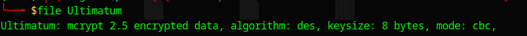
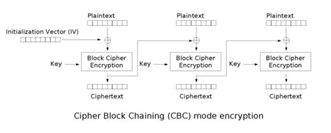
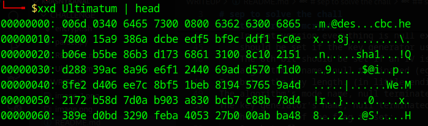
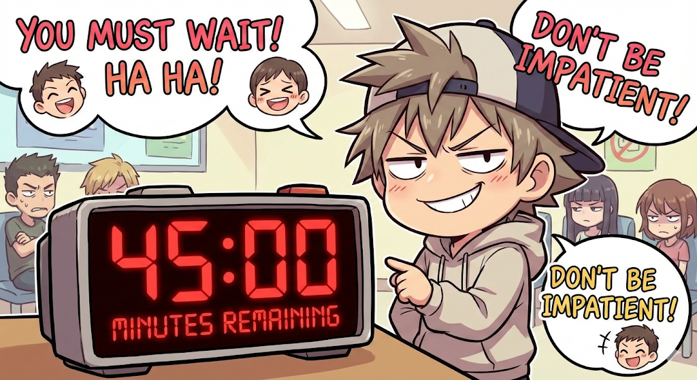
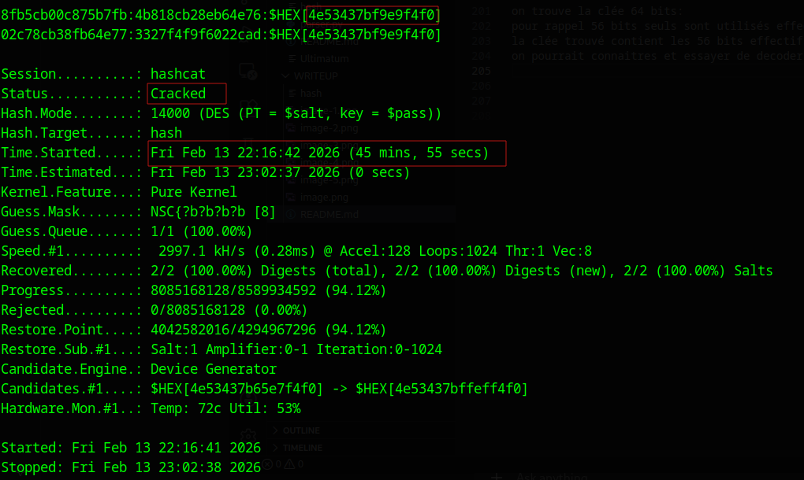

# sep to solve the chall

## file type:
le fichier Ultimatum est chiffré avec des en mode cbc



## mcrypt
mcrypt est un ancien utilitaire utilisé pour chiffré des fichiers,donc legacy system

## des
des n'est plus utilisé car la taille de la clée 64 bits ,dont 56 bits utilisé effectivement  et 8 bits sert a la parité.
par l'algo; donc bruteforçable

## analyse

```bash
mcrypt -a $ALG -c $MODE -o $KEY_MODE Ultimatum.jpg
```
le fichier chiffré est du jpeg, interessant car les 16 premiers octets sont connus:
en hexadecimal:
```
FF D8 FF E0 00 10 4A 46 49 46 00 01 01 00 00 01
```
Détail des octets :

    FF - Marqueur de début d'image (SOI - Start Of Image)

    D8 - Suite du marqueur SOI

    FF - Marqueur suivant

    E0 - Marqueur APP0 (segment d'application)

    00 10 - Longueur du segment APP0 (16 octets)

    4A 46 49 46 00 - Identifiant "JFIF" terminé par un zéro

    01 - Version majeure (1)

    01 - Version mineure (1)

    00 - Densité d'unité (0 = aucun)

    00 01 - Densité horizontale (1)

    00 01 - Densité verticale (1)

    00 - Largeur de la vignette (0)

    00 - Hauteur de la vignette (0)


et le des en mode cbc:



donc l'attaque est vulnerable au known plaintext attaque,
chaque bloque etant de 8 octets.
on connait:
p1: les 8 premiers octets du jpeg
p2: les 8 octets suivants

il nous faut juste l'iv 8 octets et deux blocks cipher de 8 octets.

## structure de mcrypt
d'apres la documentation: https://github.com/jackspirou/mcrypt/tree/master/doc

Format:
```
The output file for all the algorithms (except unix crypt) when not used in
bare mode is:

3 bytes as: NULL + "m" + \3
One byte flag:
	In that version everything is null except the 7th bit which
	should be set if the key generator uses a salt.
	The 8th bit should be set if an IV is being used.
The algorithm's name, null terminated (eg. blowfish)
Two bytes the key length. (in little endian format)
The algorithm's mode name, null terminated. (eg. cbc)
The key generator's name, null terminated. (eg. mcrypt-sha1)
If the 7th bit of the flag is set:
	One byte flag:
		The size of the salt, following that byte, 
		and it's first bit is set.
	The salt follows.
The algorithm used to compute the checksum stored at the end of file (eg. crc32), 
	also null terminated.
If the 8th bit of the flag is set:
	The IV (depending on the algorithm)
[...encrypted data...]
A checksum (eg. crc32) of the original data (encrypted). The checksum is 
appended to the end of the file to be encrypted.
```
l'iv suit imediatement l'algorithm du checksum, nous n'avons qu'a parser le fichier Ultimatum, extraire
l'iv,c1,c2




extraire iv,c1,c2:
```python
import sys

with open(sys.argv[1], 'rb') as f:
    data = f.read()

# Chercher "sha1" dans le fichier
sha1_offset = data.find(b'sha1')
if sha1_offset == -1:
    print("sha1 non trouvé")
    sys.exit(1)

print(f"Offset sha1: 0x{sha1_offset:x}")
print(f"sha1: {data[sha1_offset:sha1_offset+4].decode()}")
print(f"IV:   {data[sha1_offset+5:sha1_offset+13].hex()}")
print(f"c1:   {data[sha1_offset+13:sha1_offset+21].hex()}")
print(f"c2:   {data[sha1_offset+21:sha1_offset+29].hex()}")
```
## crack avec hashcat

hashcat attend un format specifique pour des :
le hash est de la forme:
`hex(c_n):hex(c_n-1 xor p_n)`

donc nos hashs:
```bash
hex(c1):hex(iv xor p1 )
hex(c2):hex(c1 xor p2)
```
on ecrit un script pour construire le hash
extract.py

```python
import sys

with open(sys.argv[1], 'rb') as f:
    data = f.read()

# Trouver sha1 et extraire IV, c1, c2
sha1_offset = data.find(b'sha1')
iv = data[sha1_offset+5:sha1_offset+13]
c1 = data[sha1_offset+13:sha1_offset+21]
c2 = data[sha1_offset+21:sha1_offset+29]

# JPEG header (premiers 16 octets)
jpeg_header = bytes.fromhex("ffd8ffe000104a464946000101000001")

# Calculer les clairs
p1 = jpeg_header[:8]    # 8 premiers octets
p2 = jpeg_header[8:16]  # 8 suivants

# Calculer iv xor p1
iv_xor_p1 = bytes(a ^ b for a, b in zip(iv, p1))
c1_xor_p2 = bytes(a ^ b for a, b in zip(c1, p2))

hash1 = f"{c1.hex()}:{iv_xor_p1.hex()}"
hash2 = f"{c2.hex()}:{c1_xor_p2.hex()}"

print("\nLes deux hashs:")
print(hash1)
print(hash2)
```

finalement on donne le tout a hashcat pour faire le sale boulot a notre place

```bash
hashcat -m 14000 hash -a 3 '?a?a?a?a?a?a?a?a'
```
c'est le genre de pattern qu'il faut 11 mois pour craquer , meme avec un bon gpu
il faut du temps.
on peut mieux faire car on connait le debut du flag

```bash
hashcat -m 14000 hash -a 3 'NSC{?a?a?a?a'
```
bruteforcer 4 caracteres imprimables ,se fait en moins d'une minute,mais
ce n'est pas evident car rien ne nous dis quel encodage est utilisé, et vu la description du challenge
cela provient de la russie; pour etre sûre, brute force de tous les octets "00-ff".

donc
```bash
hashcat -m 14000 hash -a 3 'NSC{?b?b?b?b'
```
on peut voir deja au pire ,il prendra 45 minutes pour explorer tout l'espace
des clés. donc 




on entend encore un peu voir


:;:;:;:;:;:;;;;;;;:::::::;::):):):):):):):):):):):)


on trouve la clée 64 bits: 4e53437bf9e9f4f0
pour rappel 56 bits seuls sont utilisés effectivement comme key.
la clée trouvé contient les 56 bits effectifs mais rien ne prouve que les autres bits sont corrects.
on pourrait connaitres et essayer de decoder en utilisant le bon encodage.

les tools ne tiennent vraiment pas comptes des autres bits ,donc on peut dechiffrer avec

```bash
mcrypt -d Ulimatum
```

apres decrypt on trouve une jolie image de cartman


### deuxieme partie: stéganographie

probablement l'image cache un secret; 
on utilise **steghide** pour extraire le contenu; mais 
probablement protegé par une passphrase, qui est en russe

la clee: key="4e53437bf9e9f4f0" is obvously  not an utf-8 cuz ,car
utilise un encodage qui supporte les caracteres de l'Europe de l'Est, les caracteres cyrylliques
ou chaque charactere est encodé sur un octet.

on peut trouver tous les clés possibles:

```python
from itertools import product
key_hex = "4e53437bf9e9f4f0"
key = bytes.fromhex(key_hex)
def set_des_parity(byte, parity):
    """
    parity = 0 → LSB = 0
    parity = 1 → LSB = 1
    """
    return (byte & 0xfe) | parity
variants = []
for mask in product([0,1], repeat=8):
    new_key = bytes(set_des_parity(b, p) for b, p in zip(key, mask))
    variants.append(new_key)
print(f"{len(variants)} clés générées :\n")
for k in variants:
    try:
        if b'NSC{' in k:
            print(k.hex(),k.decode('cp1251'),)
    except:pass
```
on trouve 16 clées

```
4e53437bf8e8f4f0 NSC{шифр
4e53437bf8e8f4f1 NSC{шифс
4e53437bf8e8f5f0 NSC{шихр
4e53437bf8e8f5f1 NSC{шихс
4e53437bf8e9f4f0 NSC{шйфр
4e53437bf8e9f4f1 NSC{шйфс
4e53437bf8e9f5f0 NSC{шйхр
4e53437bf8e9f5f1 NSC{шйхс
4e53437bf9e8f4f0 NSC{щифр
4e53437bf9e8f4f1 NSC{щифс
4e53437bf9e8f5f0 NSC{щихр
4e53437bf9e8f5f1 NSC{щихс
4e53437bf9e9f4f0 NSC{щйфр
4e53437bf9e9f4f1 NSC{щйфс
4e53437bf9e9f5f0 NSC{щйхр
4e53437bf9e9f5f1 NSC{щйхс
```
script final pour extraire,le secret .

```python
from itertools import product
import subprocess

key_hex = "4e53437bf9e9f4f0"
img = "Cartman.jpg"

key = bytes.fromhex(key_hex)

def set_des_parity(byte, parity):
    return (byte & 0xfe) | parity

for mask in product([0,1], repeat=8):
    new_key = bytes(set_des_parity(b, p) for b, p in zip(key, mask))
    try:
        s = new_key.decode("cp1251")
        if s.startswith("NSC{"):
            p = subprocess.run(
                ["steghide", "extract", "-sf", img, "-p", s],
                stdout=subprocess.PIPE,
                stderr=subprocess.PIPE
            )
            out = (p.stdout + p.stderr).decode(errors="ignore")
            if "criture des donn" in out or "writing extracted" in out.lower():
                print("[+] KEY FOUND:", s, new_key.hex())
                break
    except:
        pass

```

```
criture des donnes extraites dans "secret.txt".

[+] KEY FOUND: NSC{шифр 4e53437bf8e8f4f0
```
dans secret.txt on trouve: _DES_устарел_и_небезопасен_для_современных_систем}

le flag: [+]  NSC{шифр 4e53437bf8e8f4f0_DES_устарел_и_небезопасен_для_современных_систем}

